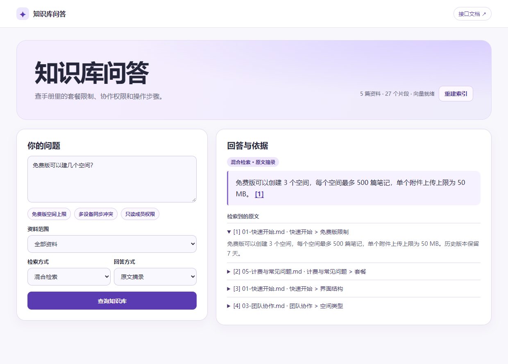

# 知识库问答

“免费版可以建几个空间？”这条信息在快速开始和计费说明里都能找到。这个项目把几篇手册做成可查询的知识库，回答旁边附上原文入口，读者可以点进去核对数字、文件和章节。



## 先试一遍

用 Python 3.12 启动。在 Windows 可以双击 `启动项目.cmd`，也可以在项目目录运行：

```sh
python -m pip install -r requirements.txt
python launch.py
```

打开 [本地页面](http://127.0.0.1:8767/)，点「免费版空间上限」并查询。答案里的 `[1]` 可以直接打开引用。再把资料范围切换到「计费与常见问题」，就能看到来源只剩所选手册。仓库内的手册是虚构产品样例。

默认用 BGE 中文向量做混合检索，从原文摘录回答。首次使用需下载向量模型，下载不成功时界面会提示，仍可选 BM25 关键词检索。

## 两处实现取舍

- **关键词和向量各自召回。** 版本号、额度和产品术语适合用 BM25 做精确匹配，换一种说法提问时向量结果可补充召回。RRF 按两路名次合并结果。指定文档时，两路都先限制候选范围，再取前几名。现有样例可以直接用 NumPy 做余弦搜索。
- **更新一小段手册时复用旧向量。** 片段正文、标题和编码配置共同决定缓存。添加或修改资料后点「重建索引」，页面显示新增编码和复用数量。新版本成功构建后才切换。一次本地验证中，新增一段资料只编码了 1 段，复用原有 27 段。

[rag_service.py](app/rag_service.py) 包含索引和问答流程。[chunker.py](app/chunker.py) 记录片段所属文档、标题或 PDF 页码。资料可放入 `docs/`，支持 Markdown、TXT、带文本层的 PDF 和 DOCX。

## 模型与测试

需要生成式回答时，复制 `.env.example` 为 `.env`，配置兼容 Chat Completions 的服务并重启。模型会收到问题和召回片段。应用校验引用编号，结论是否与原文一致仍可在页面核对。

```sh
python -m unittest discover -s tests -v
```

测试覆盖索引更新、指定文档、失败保留旧索引及重启恢复。服务启动后可查看 [API 文档](http://127.0.0.1:8767/docs)。
